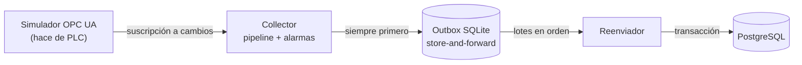

# Planta Industrial · Línea 1

Sistema de adquisición, monitoreo y (próximamente) análisis y mantenimiento para una línea de envasado simulada.
Proyecto de portafolio en Python: **OPC UA + PostgreSQL + Docker**.

> **Estado:** Fase 1 completa (adquisición y monitoreo). Siguen: tablero OEE (Fase 2) y órdenes de trabajo/inventario (Fase 3).

## Arquitectura



**Decisiones de diseño**
- **Store-and-forward:** todo registro se escribe primero en un outbox local y se borra solo cuando PostgreSQL confirma. Si cae la base, no se pierden datos.
- **Reenvíos idempotentes:** `PRIMARY KEY (tag_id, ts)`, índices únicos parciales para alarmas/eventos abiertos y `ON CONFLICT`.
- **Alarmas con histéresis:** una banda muerta evita alarmas que titilan.
- **Reconexión automática** con backoff exponencial y jitter, tanto hacia OPC UA como hacia PostgreSQL.
- **Lógica pura separada de la I/O** (`alarms.py`, `pipeline.py`), por eso es fácil de probar.

## Requisitos
- Docker Desktop (incluye Docker Compose). Para correr las pruebas fuera de Docker: Python 3.11+.

## Arranque
```bash
docker compose up -d --build
docker compose logs -f collector     # ver el collector trabajando (Ctrl+C para salir)
```

## Verificar que funciona
```bash
# Últimas lecturas
docker compose exec db psql -U planta -d planta -c "
SELECT a.code, t.name, r.ts, r.value
FROM readings r JOIN tags t ON t.id = r.tag_id JOIN assets a ON a.id = t.asset_id
ORDER BY r.ts DESC LIMIT 10;"

# Historial de estados por equipo
docker compose exec db psql -U planta -d planta -c "
SELECT a.code, s.name AS estado, e.start_ts, e.end_ts
FROM machine_events e JOIN assets a ON a.id = e.asset_id JOIN machine_states s ON s.state = e.state
ORDER BY e.start_ts DESC LIMIT 10;"

# Alarmas
docker compose exec db psql -U planta -d planta -c "
SELECT a.code, al.rule, al.severity, al.raised_ts, al.cleared_ts
FROM alarms al JOIN assets a ON a.id = al.asset_id ORDER BY al.raised_ts DESC LIMIT 10;"
```

## Probar la resiliencia (buen material para un GIF del portafolio)
```bash
docker compose stop db          # se cae la base de datos
docker compose logs -f collector   # verás "Pendientes en buffer: N" creciendo
docker compose start db         # vuelve la base
# El buffer se vacía solo y no hay huecos en las lecturas.

docker compose restart simulator   # se cae el "PLC": el collector reconecta solo
```

## Pruebas
```bash
python3 -m venv .venv && source .venv/bin/activate
pip install -r requirements-dev.txt
pytest
```

## Estructura
```
simulator/   servidor OPC UA que simula la línea
collector/   adquisición: cliente OPC UA, pipeline, alarmas, outbox, acceso a PostgreSQL
db/init/     esquema SQL y datos semilla
sql/         consultas de análisis de la Fase 1
tests/       pruebas unitarias
api-ejemplos/  ejercicios de APIs REST con FastAPI (ver su README)
spark-etl/     ETL con PySpark: limpieza y OEE por turno (ver su README)
```

## Notas para la Fase 2 (OEE)
- Los contadores `GoodCount`/`RejectCount` son **acumulados** y se reinician a 0 si el equipo se reinicia:
  al calcular piezas por periodo con `LAG()`, un delta negativo debe tratarse como reinicio.
- Todas las marcas de tiempo se guardan en UTC.

## Pendiente / mejoras
- Límite de tamaño y alerta de disco para el outbox.
- Retención y particionado de `readings` para volúmenes altos.
- Métricas del propio collector (latencia, tamaño del buffer).
